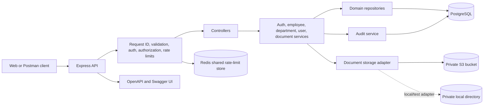
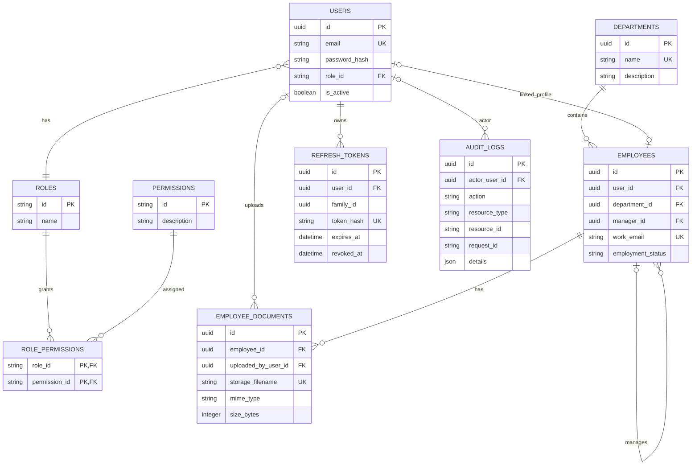

# Employee Management API: HLD and LLD

## High-level design

The API is a modular Express application. Routes authenticate and authorize each request, controllers translate HTTP input/output, services enforce business rules, repositories encapsulate persistence queries, and TypeORM maps PostgreSQL entities. Employee documents use an object-storage adapter; production uses private S3 while tests and local setups may explicitly use local storage. Production rate limits are shared through Redis.

Production startup requires PostgreSQL, S3 configuration, and `REDIS_URL`. Local development can use Redis when configured; otherwise the rate limiter uses its process-local default store. Integration tests explicitly select local document storage and use a dedicated PostgreSQL test database.

## Low-level design

### Module contracts

| Module | Contract |
| --- | --- |
| `routes/` | Declare HTTP paths, authentication, permission checks, and request validation. Routes do not contain business rules. |
| `middlewares/auth.middleware.ts` | Verify HS256 access tokens, load active account/session state through the authorization repository, and attach `{ sub, role }` to the request. |
| `middlewares/authorize.ts` | Check persisted role permissions through the authorization repository; return 401/403 or continue. |
| `controllers/` | Convert validated request data to service arguments and send the standard response envelope. |
| `services/` | Apply business policy, coordinate repositories/storage/audit, and return API-safe domain data. |
| `repositories/` | Encapsulate persistence reads and writes and return typed domain records/results, not transport responses. |
| `services/document-storage.ts` | Store, delete, and presign documents behind one adapter boundary. S3 uses bounded request timeouts; local storage is for development/test. |
| `services/audit.service.ts` | Write actor, action, resource, request ID, and details; transactional operations pass their manager. |
| `config/` | Parse environment settings and initialize PostgreSQL, Redis, and storage clients. |
| `errors/` | Map known validation, authorization, persistence, upload, timeout, and dependency errors to safe HTTP responses. |

### Request contracts

- Authentication: `Authorization: Bearer <access token>`. Access tokens are HS256, issuer/audience checked, and bound to an active refresh-token family.
- Pagination: list endpoints accept `page` (1-based, default 1) and `limit` (default 20, maximum 100). Paged responses return `{ items, pagination: { page, limit, total, totalPages } }` inside the API envelope.
- Documents: upload is multipart field `document`, one PDF/PNG/JPEG up to the configured size. The server validates extension, MIME declaration, and file signature before writing to storage. Document records contain a random storage key and metadata, not file bytes.
- Downloads: authorize before generating a time-limited S3 presigned GET URL. The URL is a bearer capability until its configured expiration; never log it or place it in public pages.
- Rate limits: separate Redis key prefixes are used for authentication and general API requests. Production requires Redis so limits are consistent across API replicas.

### Entity relationship diagram

### Error types

| HTTP status | Error code | Meaning |
| --- | --- | --- |
| 400 | `BAD_REQUEST`, `INVALID_JSON`, `INVALID_REFERENCE` | Invalid input, malformed JSON, or invalid related ID. |
| 401 | `UNAUTHENTICATED` | Missing, invalid, expired, or revoked authentication. |
| 403 | `FORBIDDEN`, `CORS_ORIGIN_DENIED` | Authenticated caller lacks permission or origin is not allowed. |
| 404 | `NOT_FOUND` | Requested record is missing or outside the caller's visible scope. |
| 409 | `CONFLICT`, `DUPLICATE_RECORD` | Unique constraint or conflicting state prevents the operation. |
| 413 | `UPLOAD_TOO_LARGE` | Upload exceeds configured size. |
| 429 | `RATE_LIMITED` | Shared request quota was exceeded. |
| 503 | `DATABASE_UNAVAILABLE`, `STORAGE_UNAVAILABLE` | PostgreSQL or object storage cannot complete the operation. |
| 500 | `INTERNAL_ERROR` | Unexpected server failure; response hides internal details and logs include request ID. |

Validation failures may include a structured list of invalid fields in `data`. Clients should use the stable error `code`, not parse message text.
